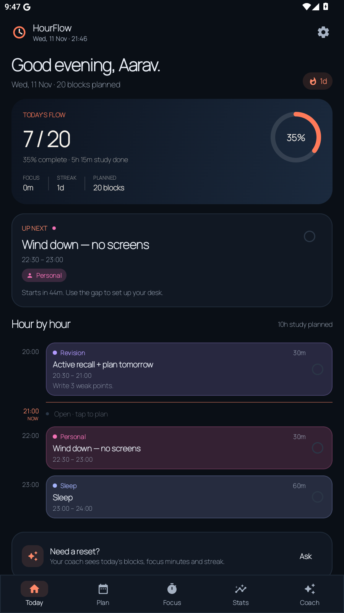
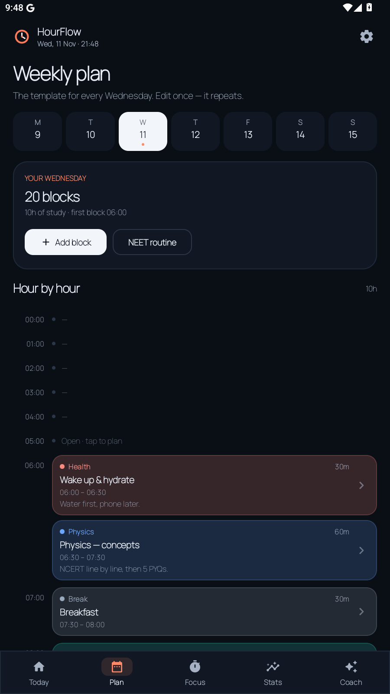
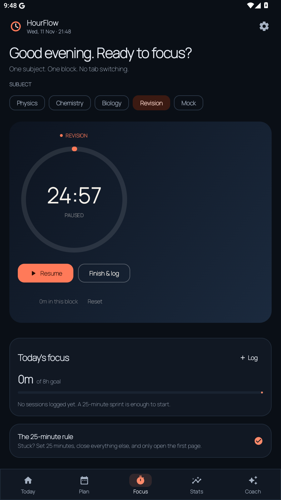
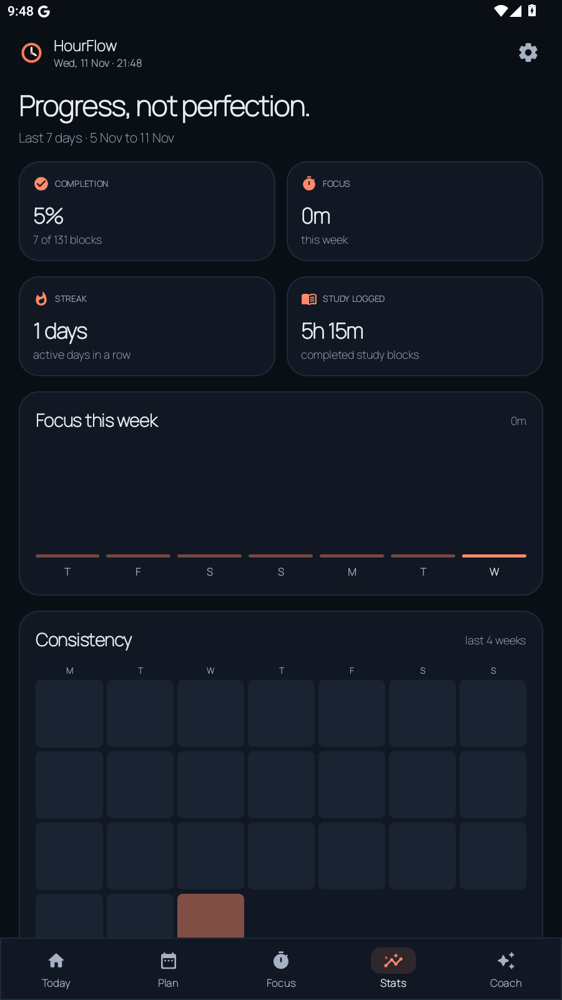

<div align="center">

# HourFlow

**An hourly routine tracker built for NEET preparation.**

Plan every hour, protect deep focus, see honest stats, and talk to an AI coach that can actually see your day.

[](https://github.com/barnikbhai2007/hourflow-android/releases/latest)
[](https://github.com/barnikbhai2007/hourflow-android/actions/workflows/build-apk.yml)
[](https://developer.android.com)
[](https://kotlinlang.org)
[](https://developer.android.com/jetpack/compose)

</div>

---

HourFlow is a calm, single-purpose study companion. No accounts, no ads, no backend. Your routine and progress live on your phone, and the AI coach is optional — bring your own Gemini or OpenAI-compatible API key.

## Screens

| Today | Plan |
|:---:|:---:|
|  |  |

| Focus | Stats |
|:---:|:---:|
|  |  |

## What it does

- **Hour-by-hour agenda** — see the whole day on one screen, with a live “now” marker, the current and next block, and one-tap completion.
- **Weekly plan editor** — repeat blocks on chosen weekdays or add a one-off block for a specific date. Edit or delete any block in place.
- **NEET starter routine** — a realistic Mon–Sat schedule plus a Sunday mock-and-review day, ready in one tap.
- **Focus timer** — pick a subject and a duration, start, pause, and keep it running across tabs. Finished timers are logged automatically.
- **Honest stats** — daily completion ring, study minutes against your target, focus minutes, 7-day completion bars, subject split, and a streak that only counts real activity.
- **Reminders** — a quiet notification five minutes before each block. Rescheduled after reboot and whenever the plan changes.
- **AI coach with live context** — the coach receives today’s blocks, completion, focus sessions, current/next block, streak, the next day’s plan, and 7/30-day trends on every message. Ask it to reset a bad evening, choose what to revise, or review your week.
- **Yours to configure** — daily study target, theme, reminder toggle, and AI provider/model/base URL.

## AI setup

The coach is a real LLM call — the app does not ship an offline chatbot or a bundled key.

1. Open **Settings → AI coach**.
2. Pick a provider:
   - **Google Gemini** — create a free key at [aistudio.google.com/apikey](https://aistudio.google.com/apikey). Default model: `gemini-2.5-flash`.
   - **OpenAI-compatible** — any endpoint that implements `POST /chat/completions` (OpenAI, OpenRouter, Groq, a local gateway, etc.). Default model: `gpt-4o-mini`.
3. Paste the key, check the model/base URL, and tap **Test connection**.

What leaves your phone: only the chat messages plus the routine snapshot described above. They go directly to the provider you chose. There is no HourFlow server. The API key is stored in the app's private `SharedPreferences`; it is not encrypted at rest, so treat it like any other key on your device and revoke it from the provider if needed.

## Install

1. Download the latest `HourFlow-v1.0.0.apk` from [Releases](https://github.com/barnikbhai2007/hourflow-android/releases/latest).
2. On Android, allow installs from your browser/file manager when prompted.
3. Open HourFlow, enter your name, keep the NEET starter routine or start empty, and set a daily study target.

Requires Android 8.0 (API 26) or newer. The APK is signed with a project keystore so future sideload updates install over the top.

## Build from source

Prerequisites: JDK 17, Android SDK Platform 35, and Android Build Tools.

```bash
git clone https://github.com/barnikbhai2007/hourflow-android.git
cd hourflow-android
echo "sdk.dir=/path/to/Android/Sdk" > local.properties
./gradlew assembleRelease
```

The APK is written to `app/build/outputs/apk/release/app-release.apk`.

A GitHub Actions workflow builds the release APK on every push to `main`, uploads it as an artifact, and publishes it to a GitHub Release when a `v*` tag is pushed.

## Tech

- Kotlin + Jetpack Compose (Material 3), single-activity architecture
- `ViewModel` + `StateFlow`; the focus timer keeps running while you move between tabs
- SharedPreferences + `org.json` persistence — no database, no network sync
- `AlarmManager` reminders with boot rescheduling
- Direct HTTPS calls with `HttpURLConnection` for Gemini and OpenAI-compatible APIs
- minSdk 26 · targetSdk 35 · AGP 8.7.2 · Kotlin 2.0.21 · Gradle 8.9

```
app/src/main/java/dev/hourflow/app
├── ai/         # provider clients + live coach context
├── data/       # models, JSON repository, NEET starter plan
├── remind/     # alarms, boot receiver, notifications
├── ui/         # screens, components, theme, view model
└── util/       # time formatting and stats
```

## Project notes

- The repository includes a self-signed release keystore so community builds and sideload updates stay consistent. It is a test/personal distribution key, not a Play Store upload key.
- Data is local to the app. Uninstalling or using **Reset everything** clears it permanently.
- The starter plan is a template, not medical or exam advice. Adjust sleep, meals, and breaks to what actually works for you.

## License

MIT — see [LICENSE](LICENSE).
